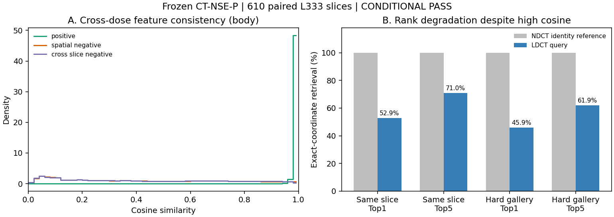

# CT-NSE-P：L333 跨剂量只读验证

**结论：CONDITIONAL PASS。** NDCT-only NSE 输入 LDCT 后，同位置特征仍接近；粗结构判别保留，但精确位置检索和弱纹理匹配下降。未启动后续 RDDM 实验。

## 实现与数据协议

NSE为6层3×3 Conv、32 channels、2 residual skips；stride=4、RF=31，46,560参数。训练只用L067/L143 NDCT，Predictor为64→128→64→32，same-map nonoverlap negatives，16 anchors/image，cosine scale=64。Adam lr=1e-3（每20 epoch ×0.2）、batch48、60 epochs、seed20260829、AMP=False。

本次冻结best_val_loss.pt（epoch60）：eval()、requires_grad=False、无optimizer/backward。完整核验610对L333 DICOM的位置/方向/spacing/InstanceNumber，以及NPY与DICOM像素一致。输入保持512×512：raw.float32-1024 → clip[-1024,3072] → (HU+1024)/4096。L506、L067/L143、external memory访问=0。

每张14,641个完整RF位置，共8,931,010个；同时报告人体区域。Spatial negative与RF不重叠；cross-slice offset305。Hard gallery为本slice及固定offset122/244/366/488的4张slice，73,205候选；query预先固定。1e-6以内cosine并列按gallery index排序。

## 关键结果（人体区域）

| 指标 | NDCT identity→NDCT | LDCT→NDCT |
|---|---:|---:|
| Positive cosine | 1.000000 | 0.995042 |
| Spatial / cross-slice margin | 0.577565 / 0.576042 | 0.572596 / 0.571090 |
| 同slice Top1 / Top5 | 100% / 100% | 52.87% / 70.96% |
| Hard Top1 / Top5 | 100% / 100% | 45.93% / 61.90% |

Positive高于两类negative=99.80% / 99.90%；610张margin均正。人体同slice误差mean44.14px、median0px。LDCT/NDCT feature std=0.094038/0.095630，均无collapse/NaN/Inf；两者均有9个near-zero channels。

## 解释与边界

16个固定可视化query中7个Top1是精确位置，部分跨slice结果具有相似轮廓；平坦区域和若干弱边界仍错配。Mean-HU-only hard Top1仅0.30%，NSE为45.93%，但特征仍明显依赖强度/粗布局。NDCT identity reference是无扰动上限，不能当作augmentation robustness测试。L333曾用于原训练checkpoint选择，本次不是未见患者泛化测试；结果不代表RDDM一定涨点。

## 文件与复现

- [训练及模型](../ct_nse_p_v1_20261005/)：NSE、Predictor、dataset、trainer、tests、原始/实际config。
- [验证代码](evaluate_crossdose.py)：pairing、全部有效位置检索、hard retrieval、统计和绘图；保留实际执行源码字节。
- [验证config](effective_config.json)、[aggregate指标](metrics.json)、[审计摘要](AUDIT_SUMMARY.json)、[来源和命令](PROVENANCE.json)、[文件哈希](MANIFEST.json)。

代码按原路径布局运行，使用已有corediff进行DICOM审计、flexict进行推理；先建logs/和visuals/，执行test_eval.py后运行launch.sh。本包仅收录轻量文件：复现需自行提供私有配对数据和匹配SHA256的checkpoint，路径按本机实际配置。没有上传checkpoint、医学图像/数组、raw feature或检索contact sheet。

Checkpoint SHA256：d684820c2af7ef9f54930fde8f5fe443e4c70062186d7f8e399175d8e12d71b7  
Original source commit：b754bcbb384ba087a15db4f4f4f9c54fbb4bfc6d
